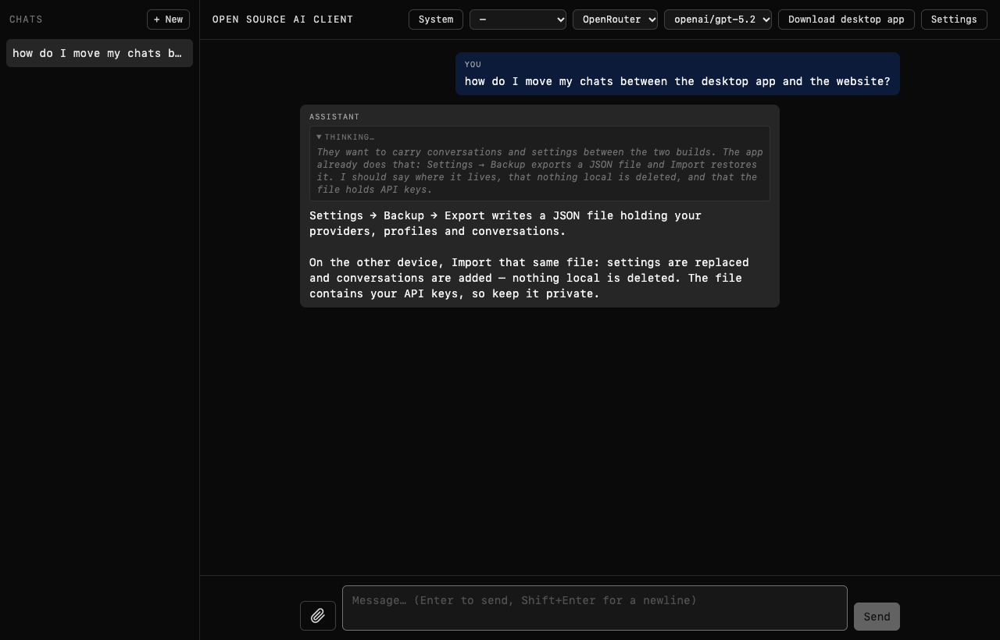
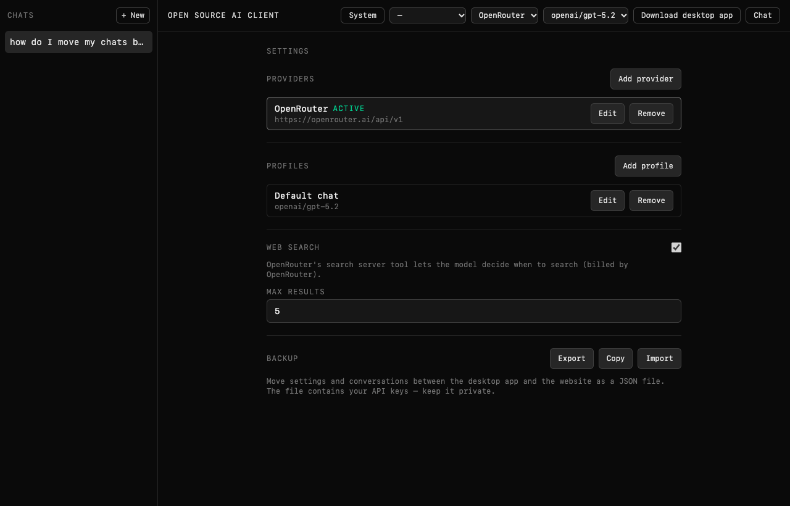

# Open Source AI Client

Desktop and web client for OpenAI-compatible and Anthropic endpoints. Tauri shell, Vite + React frontend, data stored locally.



## Highlights

- **Any OpenAI or Anthropic compatible endpoint**: no vendor lock-in.
- **Runs local models**: point it at Ollama or LM Studio and chat without a cloud account.
- **Reads pages you link**: the model can fetch a URL and answer from the page itself.
- **Small and fast**: Rust over the OS webview with no bundled browser engine, fonts or icons. ~21MB on disk.
- **Secure and private**: conversations and API keys stay on your machine, and the app has no analytics.
- **Remembers you**: durable notes the model writes as it works, plus your own, sent with every chat.
- **Updates itself**: the desktop build finds a newer release, downloads it and relaunches, and a Settings section checks on demand.
- **One codebase, two targets**: the same app ships as a desktop binary and as the website.
- **Extensible with plugins**: add UI, commands, model tools, wire protocols, themes and more from a plugin. Plugins are **full-trust** — they run in this app's own process with its privileges — so install only ones you trust; the plugin API is **unstable** at `0.1` and may change between releases ([Writing a plugin](web/plugins/README.md)).
- **Completely open source**: GPL-3.0-only, you are free to make copies as long as they are open source.

## Download

[Releases](https://github.com/JeffreyJYZ/ai-client-oss/releases/latest) publishes macOS (universal), Windows and Linux builds. The web build runs at [aiclient.jyz.land](https://aiclient.jyz.land).

macOS installs with Homebrew, and updates itself from then on:

```sh
brew trust jeffreyjyz/tap
brew install --cask jeffreyjyz/tap/oss-ai-client
```

Installing the `.dmg` by hand instead? Builds are unsigned, so clear the download quarantine flag after installing, or the app will not open:

```sh
xattr -dr com.apple.quarantine "/Applications/oss-ai-client.app"
```

On Windows, SmartScreen warns: pick **More info → Run anyway**.

## Features

- Providers: OpenAI (Responses or Chat Completions), OpenRouter, OpenCode Zen, OpenCode Go, Command Code, Ollama, LM Studio, or any OpenAI-compatible base URL.
- Streaming, and a collapsible block for reasoning models' thinking.
- Web search: the endpoint's own tool where it has one (OpenAI, OpenRouter, Anthropic), or TinyFish with your own key where it has none. That is how a local model gets search at all.
- Per-conversation system prompts, and profiles bundling provider, model and prompt.
- File and image attachments.
- Export/Import moves settings and conversations between the desktop and web builds.
- **Plugins** (off by default): contribute UI slots, commands, model tools, wire protocols, request/stream pipeline stages, themes, settings sections and renderers. A plugin runs in-process and unsandboxed by design — `plugin-data` is the only capability enforced for real (path-scoped), and `net` cannot be.



## Compatibility

Stored settings carry a `dataVersion` and a migration registry. Traversal is **forward-only**: a newer build reads and migrates data written by an older one — a blob with no `dataVersion` is lifted to the current version and no field is dropped — and conversations live in their own store, never rewritten by a settings read.

Downgrading is tolerated, not migrated. A **0.2.3** install opening data written by **0.3.0** keeps working: the added keys (`dataVersion`, `pluginsEnabled`, `plugins`) are additive and ignored by the older schema, and its conversations survive. It will not know about plugin state, and a provider pointed at a plugin-registered protocol is not usable there. Prefer moving forward.

## Development

Needs Bun and a Rust toolchain.

```sh
cd web
bun install
bun run dev        # web
bun run tauri dev  # desktop
```

Gate: `cd web && bun run verify` (tsc, Biome, the Effect language service, `bun test`).

## License

GPL-3.0-only. The 0.1.x releases were published under MIT and remain MIT.
